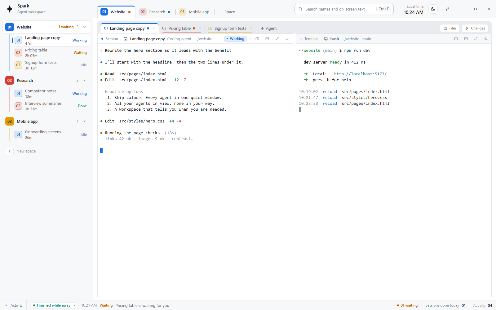

# Spark Herdr Layout

Spark is a whole-window look for the [Herdr](https://herdr.dev) desktop app: your spaces as large colored tabs across the top, every agent listed under its space in a sidebar with its status, browser-style tabs above your terminals, a quick search, and a day and a night theme. It also comes with a small always-on-top indicator for Windows that shows what your agents are doing while Herdr is in the background.

*The picture is a drawn rendition with made-up spaces and agents, not a screenshot.*

## Install

**Windows:** download or clone this repository, then double-click `install.cmd`.

- It copies the look into your Herdr home folder and never overwrites anything that is already there.
- It compiles the indicator on your own computer from the included source and starts it.
- It does not change your key bindings or your current layout.

Then, in Herdr, press Ctrl+Shift+L until Spark shows. Ctrl+Shift+L again switches back.

**macOS / Linux:** run `install.sh` (the look only; untested).

To remove everything the installer added, run `uninstall.cmd`.

Full details, the by-hand steps, and exactly what the look does on your machine are in [SETUP.md](SETUP.md). Read its "What it does on your machine" section before installing: Herdr mods are trusted code, and the search reads the visible text of your open terminals when you search.

## What is in here

| Path | What it is |
|---|---|
| `layouts/`, `mods/`, `themes/` | The look itself, the search panel, and the day and night themes |
| `extras/indicator/` | Source for the always-on-top indicator (Windows) |
| `install.cmd`, `install.ps1`, `uninstall.cmd`, `uninstall.ps1` | Windows installer and uninstaller |
| `install.sh` | macOS / Linux installer for the look only |
| `keys.json` | The one optional key binding (Ctrl+F for search), to merge by hand |
| `SETUP.md` | Setup guide and disclosure |
| `RECIPE.md` | A full description of the look, for rebuilding it from scratch |
| `claude-terminal-look/` | Optional: a status line and settings guide for Claude Code |
| `extras/multi-account/` | Optional: a launcher and Herdr menu entry per Claude Code login, and new terminals that start Claude |

## Good to know

- Made and tested on Windows 11 with herdr-app 0.1.14 and herdr-core 0.1.19. Other versions, macOS and Linux have not been tried.
- No network connections are made by the look, the search, the indicator or the installer.
- Click a dot in the indicator to jump to that agent in Herdr. Right-click it for Light or Dark, strip or stack, and Start with Windows.

## Optional: the same Claude Code terminal look

The folder `claude-terminal-look/` is separate from the Herdr look and the installer does not touch it. It holds a one-line status line for Claude Code (folder, model, context bar, usage and cost) and a short guide to the three Claude Code settings that make the terminal match: the status line, the full-screen display and colors that follow light and dark. See [claude-terminal-look/SETUP.md](claude-terminal-look/SETUP.md).

## Optional: more than one Claude Code login

The folder `extras/multi-account/` is separate too, and the installer doesn't run it. For Claude Code in WSL, it finds your logins and makes a launcher and a "Claude · <name>" Herdr menu entry for each, and it can make every new space, tab and split start Claude as the login you pick. With no login found, it changes nothing. See [extras/multi-account/README.md](extras/multi-account/README.md).

## License

MIT. See [LICENSE](LICENSE).
