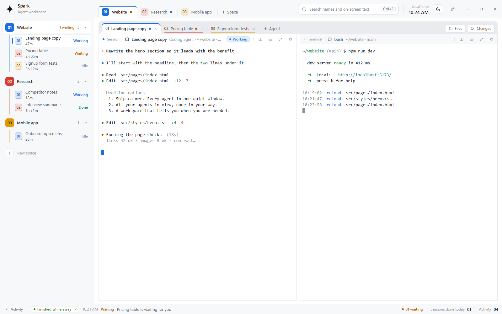

# Spark

Spark is a whole-window layout for the Herdr app: a calm, light (or dark) frame around your terminals and coding agents. Every space is a large numbered tab across the top in its own color, every agent is listed under its space in a sidebar on the left, the tabs of the space you are in sit above the terminals like browser tabs, and a slim bar at the bottom tells you what your agents last did. Nothing blinks or shouts: an agent that needs you turns amber and breathes gently, and a small banner drops in at the top.



*The picture is a drawn rendition of the look with made-up spaces and agents, not a screenshot of a running window.*

## What you see

Top to bottom, at zoom 1:

1. **Header, 58 px.** Dragging it moves the window.
   - **Brand block**, exactly as wide as the sidebar under it (it follows the sidebar when that is resized; at least 180 px, 250 on macOS, where it also leaves 84 px on the left for the window buttons). The brand icon (`mods/spark/icons/brand.svg`: a four-point star, a bare 30 px glyph in one color, Carbon `#161616` on the day look and Steel `#a9bccd` on the night look), with no box or tile around it, then the title "Spark" at 15 px semibold and the subtitle "Agent workspace" at 12 px.
   - **Space tabs**, one per space, 40 px tall with rounded top corners (10 px): the space's two-digit number in a 24 px box of the space's color, its name at 13 px, a 7 px dot when an agent there is waiting (amber) or working (blue), and "4 tabs" at 12 px. The selected space is a raised tab on the canvas color with a 3 px stripe in its color across the top and a hairline at each side; the others are flat, with a hairline on their right except next to the selected tab. Names shorten first when the window is narrow; the tab count goes next.
   - **"+ Space"** after the last tab (a bare round "+" when the layout's `plus_labels` prop is off; it is on here).
   - **Search bar**, 320 by 34 px, 9 px corners, 1 px border: a 15 px magnifier, "Search names and on-screen text", and the bound key in a small box ("Ctrl+F"). Under 1180 px of window width it is 220 px without the key; under 940 px it is a 34 px icon button.
   - **Clock**: "Local time" at 12 px over the time at 15 px semibold ("7:30 PM").
   - **Day/night button** (30 px, sun or moon), **Settings** gear (a small accent dot when an app update is ready), and, where the system draws none (Windows and Linux), minimize, maximize or restore, and close (44 px wide each; close turns red on hover).
2. **Body.**
   - **Sidebar, 300 px** (resizable from 220 to 440): one nested tree. For each space a 42 px header row (its number in a 28 px solid box of its color, its name in 13 px semibold, "1 waiting" in amber when someone there needs you, how many rows it has, and a fold arrow), then its rows indented on a 2 px line in the space's color. An agent row is 40 px: its tab number in a 24 px outlined box in the tab's color, the session's name, under it how long the agent has been going ("12m", "2h 05m") or its program name, and its status word on the right. A tab with no agent is a 36 px dim row with a terminal icon and "Shell" or "Panel". The space you are in has a white bordered header; the focused agent has a white bordered row with a 3 px bar in its tab's color. A dim dashed "New space" row closes the list, which scrolls. The Activity card at the bottom of the sidebar is off (`activity_card` prop).
   - **Work area**, padded 10 and 14 px (top and bottom, then sides):
     - **Tab row, 40 px**: a gray strip holding the shown space's tabs, browser style. Each tab is 34 px tall: its two-digit number in its color, its name, a status dot when not idle, and an "x". The selected tab is white with rounded top corners, a 3 px stripe in its color and two small 9 px curves that join it to the pane below; the others are flat with a thin underline in their color and a hairline between neighbors. Then "+ Agent", and on the right any put-away tabs to bring back and the **Files** and **Changes** buttons.
     - **Panes**: square corners, a 1 px hairline border (the same color when focused), 10 px between panes, and a **32 px header** on every pane, also on a lone one: a 6 px focus dot (accent when focused), "Session" / "Terminal" / "Panel", the program's icon, the session's name in semibold, the program, folder and branch in dim text, a status pill, then split right, split down, zoom (only when split or zoomed) and End session.
     - **Files / Changes panel**, 360 px on the right, hidden until one of the two buttons is clicked. It holds Herdr's own `files` and `changes` mods in a stack.
3. **Status bar, 32 px.** "Activity" at the left (opens the log); the latest activity line (time, a colored tag such as "Finished", the sentence); a "Finished while away" badge while an agent that finished unseen is still unseen; "02 waiting" in amber while agents are blocked; "Sessions done today 03"; and "Activity 12" (opens the log).

**Type.** One family for every panel, the layout's `ui_font`, in three sizes only (12, 13 and 15 px) and two weights only (400 and 600). Labels are sentence case. Terminals use the layout's `font`. `layouts/spark.json` sets Segoe UI and Consolas; `layouts/spark-mac.json` is the same file with Lucida Grande and Menlo.

**Color.** Everything comes from the theme, so day and night both work, and the header's button switches between them.
- Day (`themes/spark.json`): background `#ffffff`, text `#1f2329`, bars `#f7f8fa`, hairlines `#e4e6ea`, accent `#1a6fe0`; identity colors `#1a6fe0` `#d63a32` `#e39a00` `#1f9a52` `#8a45d8`; working `#1a6fe0`, waiting `#b85a00`, done `#1b8a4a`.
- Night (`themes/spark-night.json`): background `#1c1d21`, text `#e6e8ec`, bars `#232429`, hairlines `#33353c`, accent `#5b9bff`; identity colors `#5b9bff` `#f0645c` `#f2b02a` `#3fbe72` `#a874f2`; working `#62a0f8`, waiting `#eea840`, done `#4cc47f`.
- A space or tab takes the identity color of its position (first, second, ... wrapping after five), not of itself: move it and its number and color change.

## How it behaves

**Agent status.**
- **Working**: a blue dot on the space tab and the agent's tab, "Working" in blue on its sidebar row, a blue "Working" pill in its pane header. A folded space says "2 working".
- **Blocked (waiting for you)**: amber everywhere the blue was, and it breathes (opacity 0.45 to 1 every 1.8 s, native, no timer). The space header says "1 waiting", the status bar "01 waiting". A 440 by 68 px banner window opens at the top of the window with the agent's name, the time, its tab number, an **Open** button (goes to the agent) and a dismiss "x"; it closes by itself when the agent stops waiting, and moves on to the next waiting agent if there is one. On Windows, when Python is installed, a Windows notification is raised too (at most one per agent per 30 s, and not while you are looking right at that agent).
- **Done** (finished while you were not looking): green "Done"; the status bar shows "Finished while away" until you go to it (click the badge) or dismiss it.
- **Idle**: dim "Idle"; no dot.
- Every start, wait, finish and end is one line in the **activity log** (the last 80, kept in Herdr's shared state): "Docs cleanup finished", "API tests is waiting for you in Backend" (the space is named only when it is not the one on screen). The same line twice within 5 seconds is recorded once. The log opens as a 480 by 420 px window from the status bar and has a Clear button.

**Clicks.**
- A space tab or a sidebar space header: go to that space. Right-click: Herdr's space menu.
- A sidebar agent row: focus that agent. A shell row: go to that tab. Right-click: Herdr's pane or tab menu.
- The fold arrow on a space header: fold or unfold its rows with a 140 ms slide; the two arrows cross-fade. Folded spaces are remembered.
- A tab: select it. Its "x": a confirmation dialog first ("Close this tab?"; Enter confirms, Esc cancels), because closing a tab ends what runs in it. For a space's last tab Herdr asks itself, so it is asked once.
- "+ Agent": Herdr's new-agent menu. "+ Space" and "New space": a new space.
- Pane header: click to focus the pane; split right, split down, zoom; End session asks first ("End this session?").
- Search bar or its key: a 520 px dropdown opens exactly on the bar, with its own text field where the bar's text was. Up and down move, Enter goes there, Esc closes. With nothing typed it lists every open agent and shell, so it doubles as a switcher. "Show more in the search window" opens a 940 by 600 px dialog with the same search and a preview on the right. Opened by its key (`mod.open:spark-search`), the mod opens as that dialog directly. It finds two kinds of thing:
  - **Names**, as you type: projects (spaces) under "Projects", and agents and shells under "Agents", by session name, typed tab label or program name. The match is marked.
  - **Text on screen**, after a 350 ms pause in typing (3 letters or more) or on Enter (2 or more): the rows that each open terminal on this computer is showing right now and that contain what you typed, under "Text on screen", one result per terminal with "+2 more" when several rows match. While it looks, a spinner row says "Looking at the screens of 3 agents and 1 shell" with a count. In the search window the right side shows the two rows above and below the hit with the matching words marked, and "Next line in this agent" steps through that terminal's other hits. Enter or a click goes to that agent or shell. Only what is visible is searched: nothing that has scrolled away, and nothing from other machines.
- Day/night button: writes `"appearance": "light"` or `"dark"` into Herdr's `settings.json`, changing only that value.
- Settings gear: Herdr's settings. Files / Changes: show that panel, or hide it when it is already the one showing.

**Dragging.** Space tabs, agent tabs and sidebar rows all reorder the same way: after 5 px of movement with the button down the item lifts (a copy with a shadow follows the pointer inside its row), each neighbor glides aside when the dragged item's leading edge passes its midpoint, and release moves it (`space.move`, `tab.move`). Leaving the row cancels and everything glides back. A space stays among the spaces of its own machine; a tab stays inside its own space; dragging a sidebar row moves that agent's tab, so the tab row follows. The end of a drag never counts as a click.

**Hovers.** Every control has a tooltip; tooltips that mention a key read it from the key bindings, so they are right after any rebinding and show no key when none is bound.

## Built from

**Layout** (`layouts/spark.json`): a root `column`, `"titlebar": "none"`, `"traffic_lights": [16, 18]`, theme `{ light: "spark", dark: "spark-night" }`:

```
root column
  header   block 58 px, window_drag     mod spark { role: "header", palette: "multicolor", features: true, plus_labels: true }
  body     row
    sidebar  block 300 px (220..440)      mod spark { role: "sidebar", palette: "multicolor", features: true, activity_card: false }
    work     column, padding, gap 0, not resizable
      tabs       block 40 px              mod spark { role: "tabs", palette: "multicolor" }
      work-body  row, gap 10
        main     block { tab: "active", pane: { gap, radius 0, lone: true, border, focus, header: mod spark { role: "pane", palette: "multicolor" } 32 px, top, always } }
        panel    column 360 px, hidden      stack panel-body: files (mod files), changes (mod changes)
  footer   block 32 px                  mod spark { role: "status", palette: "multicolor", features: true }
```

**The look, `mods/spark/`**: one mod drawn in roles, chosen by `props.role`. Layout roles: `header`, `sidebar`, `tabs`, `pane`, `status`. Roles it opens on itself as overlays: `end` (the confirmation dialog, 420 by 196), `activity` (the log window), `alert` (the banner window, no frame). Other props: `palette: "multicolor"` (identity colors; without it everything uses the accent), `features: true` (the day/night button on the header, times on the sidebar's agent rows, the banner and notification from the status bar), `plus_labels`, `activity_card`. Modules: `activity.js`, `alert.js`, `data.js`, `end.js`, `header.js`, `kit.js`, `logic.js`, `main.js`, `names.js`, `pane.js`, `rowdrag.js`, `rowstats.js`, `sidebar.js`, `status.js`, `tabs.js`, `vivid.js`. `logic.js`, `names.js` and `rowdrag.js` import nothing from the app, so they run under plain node for tests.

**The search panel, `mods/spark-search/`**: `main.js`, `logic.js` (pure), `fixture.js` (a test seam that exports null), `mod.json` (`place: "none"`, a 940 by 600 dialog), three icons (`search.svg`, `spinner.svg`, which turns natively with `.spin(900)`, and `lines.svg`). With `props.mode === "dropdown"` it draws the compact column; the header opens it that way as a popup at the bar's position. The typed search travels from the dropdown to the window through the shared key `spark-search.handoff` (used only if under 15 seconds old, then cleared).

**Shipped mods it uses**: `changes`, `files`, `menu`, `new-menu` (Herdr's own; this package does not carry them).

**From the `herdr` module**: `agents`, `appHome`, `closeOverlay`, `exec`, `hc`, `home`, `keys`, `layout`, `nextCommand`, `notify`, `openOverlay`, `panes`, `props`, `readTextFile`, `run`, `setAgentOrder`, `setShared`, `settings`, `shared`, `spaces`, `terminals`, `theme`, `updates`, `window`, `writeTextFile`. From `fs/promises`: `exists`, `mkdir`.

**Commands it runs**: `agent.focus`, `app.settings`, `layout.hide`, `layout.select`, `layout.show`, `pane.close`, `pane.focus`, `pane.split`, `pane.zoom`, `space.close`, `space.move`, `space.new`, `space.rename`, `space.select`, `tab.close`, `tab.move`, `tab.select`, `tab.unsettle`, `window.close`, `window.maximize`, `window.minimize`.

**Programs it runs**: `hc get <terminal> --json`, once per agent, to learn when its terminal started and with what command. `hc read <terminal> --json`, from the search panel only, once per open local terminal per text search (at most 40), to get the text that terminal shows on screen; never with a line count. On Windows only, and only if a Python 3.8+ answers on the PATH (tried once per load as `pythonw`, `pyw`, `python3`, `python`, `py`): `tools/notify_toast.py`, which hands one notification to Windows PowerShell. Nothing else, and nothing over the network.

**Files it keeps**: a folder `spark-data` next to `mods/` in the Herdr home, made on demand: `diag_<role>.json` (each of header, sidebar and status writes its own counters after a minute and then every 10 minutes), `tmp/` (the notification's job file, deleted by the helper) and `toast_log.jsonl` (the last 200 notification results). An optional `config.json` there may set `toast_app_id` (the app the Windows notification is shown as; without it, Windows PowerShell).

**Shared state keys**: `spark.log`, `spark.notice`, `spark.ending`, `spark.agents.seen`, `spark.alert.dismissed`, `spark.folded`, `spark-search.handoff`.

**Key**: `keys.json` here holds the one binding the look expects, `ctrl-f` to `mod.open:spark-search`.

**Art**: 27 small stroke icons in `mods/spark/icons/` (16 px view box, `currentColor`, tinted by the mod). `brand.svg` is the brand icon (64 px view box, filled, `currentColor`); `program.svg` is the fallback for a program that has no icon of its own; `flare-l.svg` and `flare-r.svg` are the 9 px curves beside the selected agent tab.

**Also in this package, and not part of the recipe**: `install.cmd` with `install.ps1`, `uninstall.cmd` with `uninstall.ps1`, and `install.sh`, which copy the files above into a Herdr home without overwriting anything (SETUP.md says exactly what they do); and `extras/indicator/`, the C# source of the Spark Indicator, a separate always-on-top status strip for Windows that the installer compiles on the person's own computer (its own README is in that folder). A layout built from this recipe needs none of them.

## Watch out

- **Names.** A tab shows its lead agent's session name (the terminal title without its leading glyph), the same name the sidebar shows; only without one does it fall back to a hand-typed label, a shell's title, the program's name, then "Tab 3". A hand-typed label that differs is kept in the tab's tooltip.
- **No layering.** The mod API has no z-index, so a dragged item is a lifted copy drawn last in its row while the real item keeps its slot, unseen.
- **No rotation, no inset shadows, no radial gradients, no text measuring.** The fold arrow is two icons cross-fading. The stripe on a selected tab is a thin overlay with only a top border. The curves beside the selected agent tab are two tinted icons. Name widths are estimated from character counts, so names may shorten a little early or late.
- **Animate natively.** Shifts, lifts and the fold use `.transition`; the breathing uses `.loop`. No animation runs on a timer.
- **Reading a screen must never scroll it.** The search asks herdr-core for a terminal's visible screen with `hc read <terminal> --json` and nothing more. Never add a line count: that asks for history, and a history read scrolls a full-screen agent while the person is using it. The answer says how it was read; if it ever says `"how": "stitched"` (it had to scroll), the panel drops that answer and reads no more screens until it is opened again. Read nothing when the panel opens, only after the typing pause or Enter. Only terminals whose address looks local (`t` and up to 12 letters or digits) are read, and at most 40 per search. A newer search, or closing the panel, drops the older one's result. The text is cleaned of box-drawing characters before matching and is kept only in memory while the panel is open.
- **Timers** (all for data, never for drawing): the header's clock once a minute; the status bar every 800 ms (it writes queued activity lines, and compares one short string of `address:status` so it notices changes even while the window is minimized and nothing is drawn); the banner's upkeep every 3 s; the sidebar's first-seen note every 15 s and its minutes every 60 s; each role's counters every 10 minutes. The search panel has no repeating timer, only two one-shots: a refocus 600 ms after it opens, and the 350 ms typing pause (the earlier one is cancelled on every keystroke). There are no file watchers.
- **Render has no side effects** beyond queueing: shared state is written from timers and clicks, because writing shared state redraws every copy.
- **Never keep a `cx`**, and keep host calls out of module scope. The one module-level value is the cached answer to "is there a Python".
- **The checker draws one frame with no props and an empty world**, so a plain `herdr-app check` only proves the mod loads. To check a role, copy the mod, point its `from "herdr"` imports at a stand-in module that supplies that role's props and a made-up world, and read `herdr-app check <copy> --print-spec`.
- **The search dropdown's position** assumes a popup's frame pushes its content in by 1 px (`SEARCH_FRAME_BORDER` in `header.js`); if it does not, set it to 0.
- **`plus_labels` is one prop on the header block**; the tab row reads it through `layout()`. If the tab row shows a bare "+" while the header shows "+ Space", give the tabs block the same prop.
- **A tab cannot move to another space** (Herdr has no command for it), and Esc does not cancel a drag (a key only reaches a mod that holds the keyboard): move the pointer out of the row instead.
- **Limits.** The log keeps 80 lines. Identity colors repeat after five. The sidebar does not auto-scroll during a drag.
- **Assumes**: Herdr's shipped `files`, `changes`, `menu` and `new-menu` mods; herdr-app 0.1.14 with herdr-core 0.1.19 (the only versions it has run on); Windows (it has never been run on macOS or Linux, where the code paths for the window buttons and the brand block's left padding are untested).

## Done when

- `herdr-app check` passes on `mods/spark` and on `mods/spark-search`.
- After `layout.switch` to `spark` (or `spark-mac`), `herdr-app status` names that layout and lists no errors, and there is no `layout.error` or `keys.error` file.
- With two spaces and three agents: each space is a numbered tab in its own color and the selected one is raised with its stripe; the sidebar lists each agent under its space with its status word; the tab row shows the selected space's tabs with "+ Agent", Files and Changes.
- Making an agent wait turns its dot and words amber, adds "1 waiting" to its space header, opens the banner, and writes "... is waiting for you" in the status bar; answering it closes the banner.
- Dragging a space tab, an agent tab and a sidebar row each reorders it with neighbors gliding aside; a plain click still selects.
- Clicking the search bar opens the dropdown on top of the bar; typing a space's name lists it under Projects; Enter goes there.
- Typing a word that one terminal is showing, then pausing, lists that terminal under "Text on screen" with the row that holds the word; a word nobody shows gives "No open terminal shows ... on screen right now"; no terminal scrolls or loses its place while this happens.
- The day/night button switches the whole window between the two themes.
- Clicking a tab's "x" asks before closing; Esc keeps the tab.
